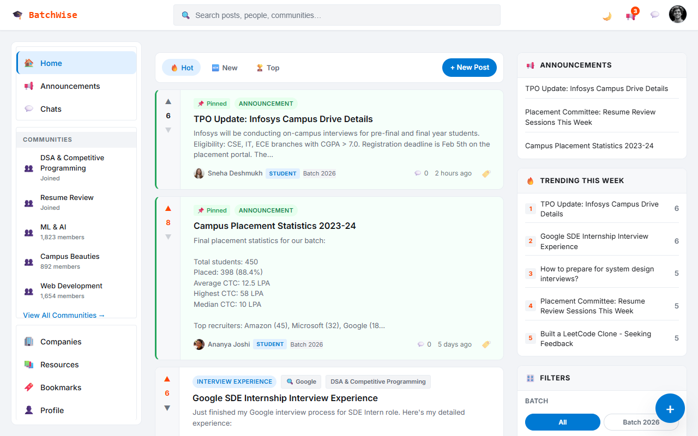
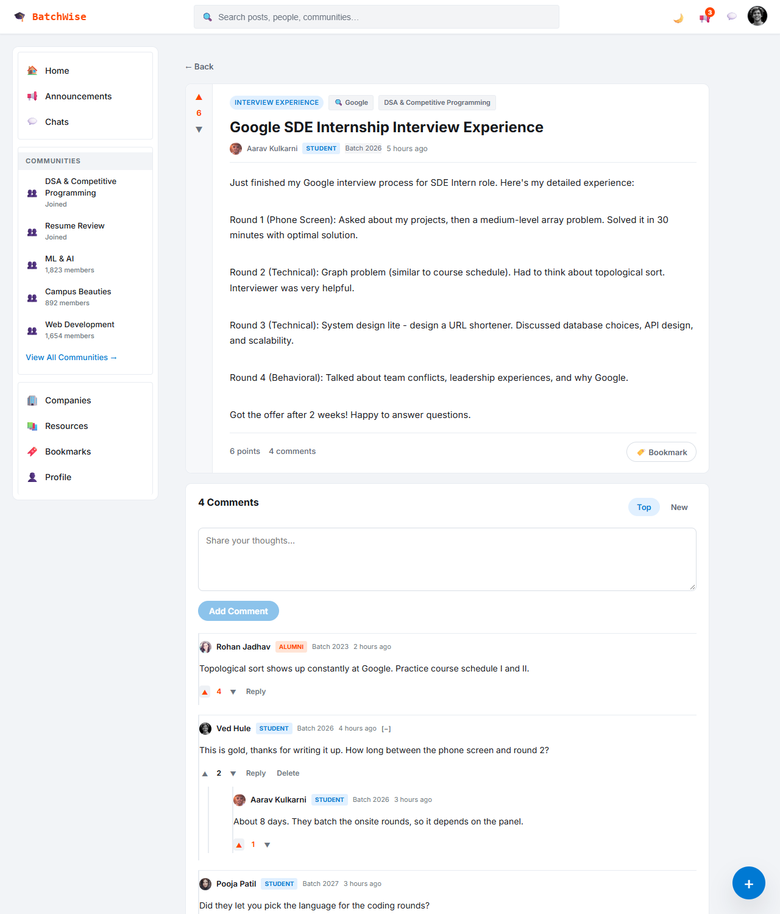
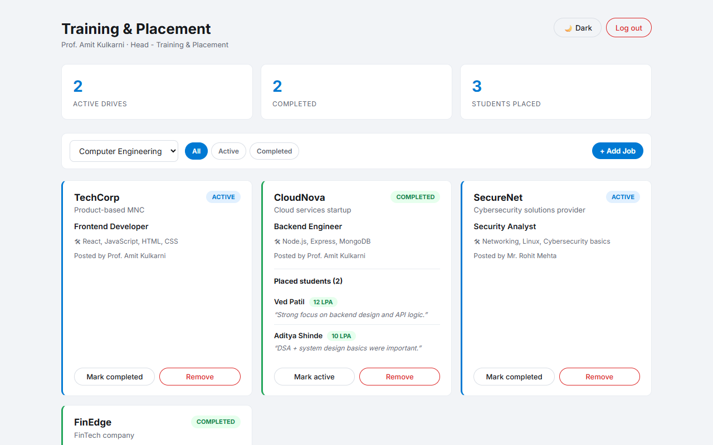

# BatchWise

Live: https://adigo112.github.io/BatchWise/

[](https://github.com/AdiGo112/BatchWise/actions/workflows/ci.yml)


A campus discussion and placement platform for students, alumni and the Training & Placement cell. React + React Router + plain CSS, no backend — all state lives in React Context and persists to `localStorage`.

| Feed | Post thread | TnP dashboard |
| --- | --- | --- |
|  |  |  |

## Quick start

```bash
npm install
npm run dev      # http://localhost:5173
npm run build    # production build
npm test         # Vitest: logic, every route, vote/comment/create-post interactions
npm run coverage # the same, with v8 coverage
```

## Demo logins

The login screen has one-click buttons for these, and a *Reset demo data* button that clears everything BatchWise stored in your browser. The passwords are demo-only and public by design; they live in `src/data/Users.js`.

| Role | Email | Password | Lands on |
| --- | --- | --- | --- |
| Student | `ved.hule@dypcoe.edu` | `ved123` | Feed |
| Alumni | `rohan.j@dycoe.edu` | `rohan123` | Feed |
| TnP / Faculty | `amit.kulkarni@dycoe.edu` | `tnp123` | TnP dashboard |

## What's in it

**Feed** — Hot / New / Top sorting (hot decays votes against age), filters by batch, community, company and post type, pinned posts float to the top.

**Posts** — real upvote *and* downvote (one vote per user, switching sides moves the vote), threaded comments one level deep with their own voting, collapse, delete-your-own, bookmark, delete-your-own-post.

**Communities & companies** — join/leave, per-community feeds with their own sorting, company pages tabbed by interview experiences / discussions / announcements, all counts computed from real posts.

**Search** — posts, people, communities, companies and resources, with per-type tabs. Every result is clickable.

**Profiles** — `/profile` for you, `/profile/:id` for anyone; posts, karma, saved posts and an about tab.

**Chat** — pick anyone in the directory and actually send messages; threads persist.

**TnP dashboard** — drives per department, active/completed filter, placement stats, add and remove drives, show the students placed through each completed drive.

**Everywhere** — dark mode (follows the OS on first visit, then remembers), mobile drawer navigation, keyboard focus rings, empty states, 404 route.

## What I built and why

**Vote model.** A post or comment holds two arrays of user ids, `upvotes` and `downvotes`; the score is their difference. `applyVote(item, userId, dir)` in `AppContext.jsx` removes the user from the opposite side, then toggles them on the chosen side. One user therefore has at most one vote, clicking the same arrow again takes it back, and switching sides moves the vote instead of counting it twice. Storing ids rather than a counter is what makes all three properties fall out of a set operation. Announcements cannot be downvoted, and a new post starts with its author's upvote.

**Hot ranking.** The feed's *Hot* sort is

```
hotness = score / (ageHours + 2) ^ 1.5
```

where `ageHours` is the time since the post was created. The `+ 2` stops a brand-new post dividing by almost nothing, and the 1.5 exponent makes votes decay quickly, so a 2-hour-old post with 5 votes outranks a 200-hour-old post with 20 (this case is in the tests). *New* sorts by `createdAt`, *Top* by raw score, and pinned posts are moved to the top after any sort. The *Trending this week* panel only considers posts from the last 3 days.

**Role-based routing.** There is one user directory (`src/data/Users.js`) for both login and authorship. Each user has an `accountType` that decides routing and a `role` that only decides the badge. `App.jsx` sends signed-out visitors to `/login` for any path. Once signed in, `accountType: "tnp"` renders the `TnpDashboard` for every path, and everyone else gets the `Layout` with the feed and its sub-routes. The session stores only the user's id and re-resolves it against the directory on load, and it syncs across tabs via the `storage` event.

**TnP flow.** The placement cell sees drives for one department at a time (Computer Engineering, IT Engineering, AI & DS), filtered by All / Active / Completed, with counts of active drives, completed drives and students placed. *Add Job* opens a modal that requires a company name and a role, and adds the drive as active. Each card can be marked completed or active again, or removed. Completed drives list their placed students with package and a quote. Drives persist under `batchwise:tnp:jobs`.

## Quality

- **Tests**: Vitest with jsdom and React Testing Library (`src/test/`). They cover the vote and ranking logic, render every route as a student and the dashboard as TnP, and click through voting, commenting and creating a post. Coverage (v8, `npm run coverage`): 85.5% statements, 71.7% branches.
- **Lighthouse** (13.5.0, desktop headless Chrome, the login page served by `vite preview` at `/BatchWise/`): Performance 99, Accessibility 100, Best Practices 100.
- **Accessibility**: every input and select has a label, the main content sits in a `<main>` landmark, text colours meet 4.5:1 in both themes, and focus rings are visible.

## Project structure

```text
src/
├── components/       Navbar, LeftSidebar, PostCard, VoteBar, Comment, FloatingActionButton, Layout
├── pages/            Home, PostDetail, Communities, CommunityDetail, Companies, CompanyDetail,
│                     Resources, Search, Bookmarks, Announcements, ChatDefault, CreatePost,
│                     Profile, Setting, Login
│   └── tnp/          TnpDashboard, JobCard, AddJobModal
├── context/          AuthContext (session), AppContext (content + actions)
├── data/             Users.js (the single user directory), Mockdata.js (content), Jobs.js
├── styles/           Styles.css (tokens + base), Shell.css (layout + components),
│                     ChatDefault.css, Announcements.css, Tnp.css
├── theme.js          light/dark
├── utils.js          timeAgo / formatDate / compact, via Intl
└── test/             Vitest + Testing Library: logic, routes, interactions
```

## State & persistence

`AuthContext` stores only the logged-in user's **id** in `localStorage` and re-resolves it against the directory on load. `AppContext` persists posts, bookmarks, joined communities and read announcements under keys namespaced per user (`batchwise:<id>:*`), so two accounts on one machine don't share state. Settings → *Reset demo data* clears the current user's data; the login page's *Reset demo data* clears everything the app stored.

## Theming

All colour lives in CSS custom properties on `:root` in `src/styles/Styles.css`, restated once under `[data-theme="dark"]`. To restyle the app, change the tokens — not the rules.

## Known limitations

- No backend: data is per-browser, and "sending" a chat message doesn't reach anyone.
- Demo passwords are plaintext in the seed data. This is a prototype, not an auth system.
- No pagination — every post renders at once.
- No markdown or image uploads in posts; line breaks are preserved, nothing else.
- Comment nesting is capped at one level by design.
